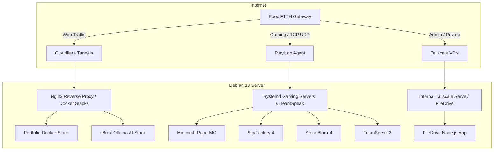

# Homelab Infrastructure

Professional declarative Infrastructure-as-Code (IaC) repository for self-hosted services running on a dedicated Debian 13 server.

## Overview & Hardware Specs

- **OS:** Debian GNU/Linux 13 (Trixie) 6.12 Kernel
- **Processor:** AMD Ryzen 5 5500 (12 Threads)
- **Memory:** 16 GB DDR4 RAM
- **Storage:**
  - ` / ` (NVMe/SSD): 110 GB (System & OS)
  - ` /srv/data ` (HDD): 1.8 TB Persistent Data & Storage (`/srv/data/drive`, `/srv/data/personal`, `.trash`, `.uploads`)

---

## Network Architecture

Inbound traffic flows securely through dedicated tunnels, VPNs, and proxies before reaching containerized or systemd-managed services.



---

## Hosted Services Inventory

| Service | Orchestration | Exposure | Description | Working Directory |
| :--- | :--- | :--- | :--- | :--- |
| **Portfolio** | Docker Compose | Cloudflare / Tailscale | Personal portfolio website & Node.js API relay | `/opt/portfolio` |
| **FileDrive** | Systemd (`filedrive`) | Tailscale Serve | Self-hosted file manager with SQLite & local storage | `/opt/filedrive` |
| **n8n + Ollama** | Docker Compose (`n8n-stack`) | Cloudflare Tunnel | Workflow automation engine & local LLM server | `/opt/n8n-stack` |
| **Minecraft PaperMC** | Systemd (`minecraft`) | Playit.gg | Main modded/vanilla PaperMC Minecraft server | `/opt/minecraft` |
| **SkyFactory 4** | Systemd (`skyfactory4`) | Playit.gg | Minecraft modpack server (Java 8 / Forge 1.12.2) | `/opt/skyfactory4` |
| **StoneBlock 4** | Systemd / Shell (`stoneblock4`) | Playit.gg | Minecraft modpack server (Java 21 / NeoForge 21.1) | `/opt/stoneblock4` |
| **TeamSpeak 3** | Systemd (`teamspeak`) | Playit.gg | Voice communication server | `/opt/teamspeak` |

---

## Repository Structure

```text
homelab-infrastructure/
├── docker/
│   ├── n8n-stack/
│   │   └── docker-compose.yml
│   └── portfolio/
│       ├── docker-compose.yml
│       └── nginx.conf
├── systemd/
│   ├── filedrive.service
│   ├── filedrive-maintenance.service
│   ├── filedrive-maintenance.timer
│   ├── minecraft.service
│   ├── n8n-stack.service
│   ├── playit.service
│   ├── portfolio.service
│   ├── portfolio-sync.service
│   ├── portfolio-sync.timer
│   ├── skyfactory4.service
│   └── teamspeak.service
├── scripts/
│   ├── skyfactory4/
│   │   ├── ServerStart.sh
│   │   └── settings.sh
│   └── stoneblock4/
│       ├── run.sh
│       └── user_jvm_args.txt
├── .env.example
├── .gitignore
└── README.md
```

## Author

Managed by **TLableigne** (`thom1.lableigne@gmail.com`).
